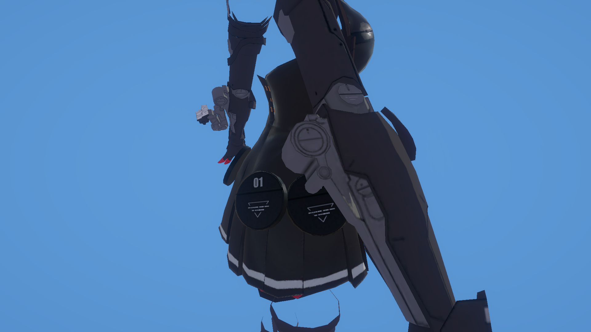

# 战双 V1 衣服渲染还原记录

记录日期：2026-11-07。

本目录记录《战双帕弥什》V1 露西亚角色衣服的 Unity URP 渲染学习进度。实现以观察游戏画面、分析现有贴图和对照教程为基础，按功能逐步搭建；尚未完成与游戏画面的完整匹配，也不是游戏原始 Shader 的提取版本。

目前主要检查衣服、机械件和腰部圆盘。皮肤、脸、眼睛、头发和武器还原不属于本阶段。

## 环境与入口

- Unity：`6000.2.10f1`。
- Universal Render Pipeline：`17.2.0`。
- 当前验证平台：Windows Editor。
- 场景：[`Assets/Scenes/Charecter.unity`](../../Assets/Scenes/Charecter.unity)，沿用工程原有拼写。
- 材质：[`R2Luxiya01001Cloth.mat`](../../Assets/Arts/R2LuxiyaMd010031/Materials/R2Luxiya01001Cloth.mat)。
- Shader：[`PunishingCloth.shader`](../../Assets/Arts/R2LuxiyaMd010031/Shaders/PunishingCloth.shader)，名称为 `CartoonShading/PunishingCloth`。
- 独立高光方法：[`PunishingClothSpecular.hlsl`](../../Assets/Arts/R2LuxiyaMd010031/Shaders/PunishingClothSpecular.hlsl)。
- 场景环境数据：[`Assets/Scenes/Charecter/`](../../Assets/Scenes/Charecter/)，包含光照数据和反射 Cubemap，应与场景及其 `.meta` 一起保留。

使用对应 Unity 版本打开项目，等待依赖恢复和资源导入，然后打开上述场景，在 Game 或 Scene 窗口查看。当前场景主要显示 `R2Luxiya01003Cloth`，其他角色部件可以按需要单独启用。

## 当前画面

以下是记录时使用场景 Main Camera 原位捕获的 Game 画面，仅作为本次进度快照：



当前仍在调整衣料与硬质机械件的材质区分、宽高光的形状以及圆盘随视角整片提亮的效果。

## 已实现的功能

| 功能 | 当前实现 |
| --- | --- |
| 贴图采样 | BaseColor、AOMap、NormalMap、PBRMap，分别支持 Tiling / Offset |
| 法线 | 顶点阶段准备世界空间 TBN，片元阶段解包法线并转换、归一化 |
| NPR 漫反射 | 带软过渡的明暗二分，以及可调暗部颜色 |
| 固有阴影 | AOMap.g 黑白点重映射，再限制二分亮部 |
| PBR 漫反射 | 标准 Lambert 与复用 NPR 二分阴影两种模式 |
| PBR 直接高光 | URP 原版 DirectBRDFSpecular，或只改写 GGX D 项的风格化版本 |
| 高光对比 | 两层 D 阈值亮斑，每层可独立混合原始 D 与风格化 D |
| PBR 间接光 | 球谐环境漫反射，以及天空环境 / 反射探针的镜面反射 |
| NPR/PBR 混合 | 使用 PBRMap.a 对两条分支的完整结果插值 |
| 贴图调试 | 独立贴图槽，支持 RGB、R、G、B、A，开关关闭时移除调试采样路径 |

独立 NPR 高光的 Properties 和注释代码仍保留，但目前不参与输出。当前衣服高光主要走 PBR 分支。

## 贴图与通道

以下是当前 Shader 实际使用的通道，不应直接推断为其他角色或版本的通用约定。

| 输入 | 当前文件 | 当前用途 | 导入设置 |
| --- | --- | --- | --- |
| `_BaseMap` | `R2Luxiya01001Cloth.png` | RGB：基础色；当前不使用 Alpha 做透明或裁剪 | sRGB 开启 |
| `_AOMap` | `R2Luxiya01001ClothAO.png` | R：风格化 D 项的形状遮罩；G：固有阴影；B/A 暂未用于最终输出 | sRGB 关闭，Default |
| `_NormalMap` | `R2Luxiya01001ClothNM.png` | 切线空间法线 | Normal Map，sRGB 关闭 |
| `_PBRMap` | `R2Luxiya01001PBR.png` | R：金属度；G：光滑度；B：AO；A：NPR/PBR 混合权重 | sRGB 关闭，Default |
| `_DebugMap` | 手动指定 | 只供调试查看，不作为正常渲染的额外材质输入 | 按待检查贴图原有设置导入 |

`AOMap.r` 当前只影响经过 smoothstep 的 D 项；每层权重为 0 的原始 GGX 路径不会被这个遮罩衰减。参考教程对 LightMap 通道的解释存在差异，需要以实际贴图和画面验证为准。

### 固有阴影为什么需要重映射

当前衣服 AOMap.g 的普通区域约为 `88 / 255 = 0.345`，并非白色 1。直接乘到二分结果上，会让普通区域也进入偏暗的颜色。之前开启 sRGB 时，该值在线性渲染中的采样还会进一步降低。

当前先使用黑白点将普通灰底映射到 1，将凹陷处的黑色映射到 0，再参与明暗混合：

```hlsl
remappedShadowAO = smoothstep(黑点, 白点, aoMap.g);
shadowAO = lerp(1, remappedShadowAO, 固有阴影强度);
finalLightBand = lightBand * shadowAO;
toonDiffuseTint = lerp(暗部颜色, 1, finalLightBand);
```

黑白点相等或顺序颠倒时，代码会整理为有效的递增区间。黑色遮罩使表面进入设定的暗部颜色，不是直接把基础色乘成纯黑。

## 光照计算流程

```text
采样四张贴图
  -> 读取金属度、光滑度、AO 与 NPR/PBR 权重
  -> 解包 NormalMap，通过插值后的 TBN 转成世界空间法线
  -> 计算主光 NdotL，以及相机观察方向
  -> smoothstep 二分 + AOMap.g 重映射，生成共用亮暗乘色
  -> NPR 漫反射
  -> 初始化 URP BRDFData
  -> PBR 直接漫反射 + 直接高光
  -> PBR 环境漫反射 + 环境镜面反射
  -> 按 PBRMap.a 混合 NPR 与 PBR
```

### 共用阴影与标准 PBR

NPR 漫反射使用 `BaseColor * toonDiffuseTint`，再乘主光颜色、距离衰减和当前 PBRMap.b 的 AO。

PBR 直接漫反射有两条路径：

```hlsl
// 关闭二分开关：标准 Lambert 直接漫反射。
PBRDirectDiffuse = brdfData.diffuse * directLightColor * saturate(NdotL);

// 开启二分开关：与 NPR 共用颜色、明暗边界和固有阴影。
PBRDirectDiffuse = brdfData.diffuse * directLightColor * toonDiffuseTint;
```

二分模式不再重复乘 NdotL，避免暗部归零。PBR 仍保留金属度导致的漫反射能量分配，因此共用阴影色不等于两条分支亮度完全相同；纯金属的 PBR 漫反射仍为零。

NdotL 对应表面反射方程中 BRDF 外的余弦项。当前 Shader 自己组装直接光照，没有调用完整的 `LightingPhysicallyBased()`，所以在 Shader 内显式乘入一次。直接高光仍使用标准的外部 `saturate(NdotL)`。

### GGX D 项风格化

`PunishingClothSpecular.hlsl` 从当前 URP 的 DirectBRDFSpecular 中拆出 D 项，使用两组 smoothstep 形成不同范围的亮斑，然后保留 URP 的 V/F 合并近似和调用方的反射颜色、光照乘法。

```hlsl
maskedD = originalD * saturate(aoMap.r);
band1 = smoothstep(阈值1 - 半宽1, 阈值1 + 半宽1, maskedD) * 强度1;
band2 = smoothstep(阈值2 - 半宽2, 阈值2 + 半宽2, maskedD) * 强度2;
layer1 = lerp(originalD, band1, 风格化权重1);
layer2 = lerp(originalD, band2, 风格化权重2);
finalD = lerp(layer1, layer2, 两层混合);
```

- 关闭“启用 GGX D 项风格化”时，调用 URP 原版高光。
- 每层风格化权重为 0 时，使用原始 D；为 1 时，使用阈值亮斑。
- 每层亮斑强度仅作用于风格化部分，不会调节权重为 0 的标准高光。
- 两层混合为 0 / 1 时，可分别观察第一层 / 第二层。
- 当参与混合的层都不使用风格化时，直接调用 URP 原方法，保持标准端点。
- D 可以大于 1；当前 Inspector 将两层阈值开放为 `0～2`。需要更高阈值时应扩展属性范围。
- 这里的 D 沿用 URP 的归一化约定，与包含 `1/PI` 的标准 NDF 尺度不同，教程阈值不能直接照搬。
- 调节 smoothstep 的阈值和宽度不能完整恢复原始 GGX 曲线；恢复原版应使用风格化权重或总开关。

### 环境光从哪里来

- `SampleSHPixel()`：读取 Unity 为物体准备的球谐环境照明。
- `GlossyEnvironmentReflection()`：读取天空环境或可用的反射探针反射。
- `EnvironmentBRDFSpecular()`：结合粗糙度和视角处理间接镜面反射。
- PBRMap.b 在 PBR 分支中衰减间接漫反射和间接镜面反射，不额外衰减 PBR 直接光。

设置入口：`Window > Rendering > Lighting > Environment`，分别检查 `Skybox Material`、`Environment Lighting` 和 `Environment Reflections`。

本次场景保存状态仍使用 Unity 内置 `Default-Skybox`，环境光强度为 1，环境反射强度为 0.5；已保存关联的 LightingData 和反射 Cubemap。Main Camera 使用 Solid Color 背景，所以 Game 窗口不显示天空背景，但环境照明和反射仍可生效。

当前版本在最终 PBR 合成中直接相加完整的间接镜面反射，已不再使用早期临时的 `PBRIndirectSpecular * 0.1`。

## 参数与调试用法

| 分区 | 主要属性 | 调节用途 |
| --- | --- | --- |
| 法线 | `_NormalScale` | 0 对照模型法线，1 使用贴图原强度 |
| 共用二分 | `_ShadowColor`、`_ShadowThreshold`、`_ShadowSoftness` | 阈值增大扩大暗部；半宽减小使边界更硬 |
| 固有阴影 | `_ShadowAOBlackPoint`、`_ShadowAOWhitePoint`、`_ShadowAOStrength` | 普通区域映射成 1，强度设 0 可直接对照 |
| 金属度 | `_MetallicScale`、`_MetallicOffset` | `saturate(PBRMap.r * 倍率 + 偏移)` |
| 粗糙度 | `_RoughnessScale`、`_RoughnessOffset` | `saturate((1 - PBRMap.g) * 倍率 + 偏移)`；之后转换回光滑度传给 URP |
| 漫反射模式 | `_PBRDiffuseToon` | 关闭为标准 PBR，开启共用二分阴影 |
| GGX 风格化 | `_PBRSpecularStylized`、`_GGXFirst*`、`_GGXSecond*`、`_GGXLayerBlend` | 原版、单层亮斑、两层亮斑对照 |
| 贴图调试 | `_DebugTextureEnabled`、`_DebugMap`、`_PreviewChannel` | 勾选开关后选择 RGB / R / G / B / A |

金属度或粗糙度倍率设为 0 时，可以用偏移指定整张材质的固定值。单通道调试将该通道复制到 RGB，以不透明灰度显示，特别适合观察 Alpha。

调试使用 `_DEBUG_TEXTURE` 片元关键字：开启时直接输出调试贴图，绕过正常光照；关闭时不执行该贴图采样。GGX 风格化使用 `_PBR_SPECULAR_STYLIZED` 片元关键字。

保存材质中的部分对照值：粗糙度倍率 `1.169`、偏移 `0.095`；固有阴影黑点 `0`、白点 `0.346`；第一层风格化权重 `0.49`，第二层为 `1`，两层混合 `0.5`。这些是实验参数，不是原版标准参数，Shader 默认值与保存材质值可能不同。

## 当前限制与后续方向

- 当前为单个不透明 Forward Pass，没有透明、Alpha Clip、自发光或专用描边。
- 主光使用无参 `GetMainLight()`，`shadowAttenuation` 当前为 1；尚未接收主光实时阴影，也没有专用 ShadowCaster / DepthOnly / DepthNormals Pass。
- 只显式计算主光直接光照，没有额外灯光循环、烘焙 Lightmap 或 APV 的完整接入。
- NPR 分支不包含当前 PBR 的环境照明；NPR/PBR 交界仍需检查亮度一致性。
- 独立 NPR 高光已停用。遗留 Properties 和注释代码可以在后续确认不再需要时清理。
- 衣料、机械件和圆盘仍共用一套全局调节参数；后续应确认遮罩后分别校准。
- 圆盘整片提亮需要继续对照顶点法线、直接高光和环境反射，不能仅靠增加高光强度判断原因。
- 边缘光、描边、有限的接触阴影以及最终后处理仍待完善。
- 常量缓冲区使用统一的 `UnityPerMaterial`，但字段排列尚有可压缩的填充；后续可在不改变所有变体布局一致性的前提下整理。

建议后续按“固定照明与视角 → 分离各项光照输出 → 校准区域材质 → 完善轮廓与阴影”的顺序继续。

## 验证与代码约定

- 已在当前 Windows Editor 中检查正常 / 调试与原版 / 风格化高光的四种关键字组合，材质 Pass 可用，Shader 编译消息为空。
- SRP Batcher 兼容性检查通过；不代表已经完成跨平台、构建或性能验证。
- Shader 按功能分块，使用中文注释说明用途与实现目的；新增材质参数进入同一个 `UnityPerMaterial`。
- 项目通过 URP include 使用官方光照函数，不修改 `Library/PackageCache` 中的包源码。
- `Library/`、`Temp/`、`Logs/` 和工具生成的临时截图不纳入版本控制；本目录展示用截图单独保存在 `images/`。

## 参考

- [酱酱紫仙贝：《战双帕弥什 V1 人物渲染还原》](https://zhuanlan.zhihu.com/p/4739701441)：衣服 NPR/PBR 混合、固定阴影、GGX 风格化、间接光和边缘光等思路。
- [挽秋：《战双卡通渲染复现》](https://xiatianlaila.github.io/2023/10/14/战双卡通渲染复现/index.html)：贴图分析、明暗截断及高光混合实验。
- [JiaT-T/Unity-PGR-Character-Rendering](https://github.com/JiaT-T/Unity-PGR-Character-Rendering)：其他角色版本的 URP 组织和材质表现参考，不直接套用其通道定义。
- [Unity：自定义 URP Shader 的间接光](https://docs.unity.cn/6000.0/Documentation/Manual/urp/use-built-in-shader-methods-indirect-lighting.html)。

这些资料作为实现参考，具体通道和公式选择以当前资源与画面对照为准。
